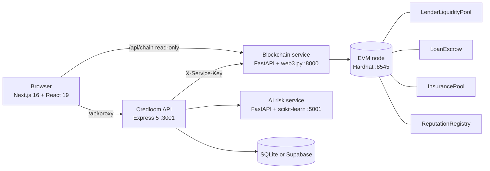

# Credloom

**Decentralized micro-lending marketplace using blockchain, AI risk assessment and smart contracts.**

Reputation replaces collateral. Borrowers are scored by a machine-learning model, lenders escrow ETH in smart contracts under their own rules, insurers underwrite defaults for a premium, and a permanent on-chain record makes repayment the rational choice.

BCSE497J Project, Vellore Institute of Technology (SCOPE)
Team: Sarthak (23BCI0139) · Kritika Varyani (23BCI0157) · Rishit Chaudhary (23BCT0157)
Faculty guide: Prof. Kaushik Hariharan G

## Contents
- [What it does](#what-it-does)
- [Architecture](#architecture)
- [Quick start](#quick-start)
- [Demo accounts](#demo-accounts)
- [Repository map](#repository-map)
- [Tests](#tests)
- [Key results](#key-results)
- [Security and honest limitations](#security-and-honest-limitations)
- [Documentation index](#documentation-index)

## What it does

| Role | Can do |
|---|---|
| **Borrower** | Get an explainable 0–1000 AI credit score, see a personalised APR, browse on-chain offers, borrow with no collateral, repay in parts or in full, verify (ENS, passport) to raise the score |
| **Lender** | Escrow ETH in an offer with a minimum score, term and APR band; the contract itself enforces those rules; withdraw an unmatched offer; track interest earned and defaults |
| **Insurer** | Stake ETH, publish a premium, accept policies; coverage is reserved per loan; a default pays the lender automatically |
| **Everyone** | Inspect every block, transaction and decoded contract event in the built-in explorer; see protocol analytics |

Every blockchain action opens a **transaction visualizer** that shows the path through the stack (auth, AI, signing, broadcast, mining, indexing) and then the real receipt: block, hash, gas, fee and each smart-contract event explained in plain English.

## Architecture



| Layer | Folder | Port | Stack | README |
|---|---|---|---|---|
| UI | `frontend` | 3000 | Next.js 16, React 19, Tailwind 4 | [frontend/README.md](frontend/README.md) |
| API | `backend` | 3001 | Express 5, JWT, bcrypt, SQLite / Supabase | [backend/README.md](backend/README.md) |
| AI risk | `mlModel` | 5001 | scikit-learn, FastAPI | [mlModel/README.md](mlModel/README.md) |
| Chain bridge | `blockchain-service` | 8000 | FastAPI, web3.py | [blockchain-service/README.md](blockchain-service/README.md) |
| Contracts | `blockchain` | 8545 | Solidity 0.8.28, Hardhat | [blockchain/README.md](blockchain/README.md) |

**Request path.** The browser only talks to Next.js. Writes go browser → Next proxy → API → blockchain service → contracts; the API holds the shared service key, so the browser can never sign or call write endpoints directly. The chain proxy exposed to the browser is read-only.

**Life of a loan.**
1. The AI model scores the borrower; the API prices the APR (25% at score 0 down to 5% at 1000).
2. A lender escrows ETH in `LenderLiquidityPool` with rules (term, minimum score, APR band).
3. The borrower picks the offer. The API (the "credit oracle") attests the score and APR; **the contract verifies the lender's rules itself**, then `LoanEscrow` releases the principal. If insured, the premium is withheld and the insurer's coverage is reserved.
4. Repayments (partial or full) are forwarded to the lender immediately; a full repayment improves on-chain reputation.
5. After the deadline anyone can settle a default: insurance pays the lender and the borrower is permanently flagged in `ReputationRegistry`.

## Quick start

**Requirements:** Node.js 22+ (uses the built-in `node:sqlite`; developed on 26), Python 3.10+ (developed on 3.13), npm. Google Chrome is optional (only for UI testing).

```bash
# one-time installation
(cd blockchain && npm install)
(cd backend && npm install)
(cd frontend && npm install && npm run build)
(cd blockchain-service && python3 -m venv venv && ./venv/bin/pip install -r requirements.txt)
(cd mlModel && python3 -m venv venv && ./venv/bin/pip install -r requirements.txt)

# configure (defaults work for a local demo)
cp backend/.env.example backend/.env                    # then set JWT_SECRET and SERVICE_API_KEY
cp blockchain-service/.env.example blockchain-service/.env   # SERVICE_API_KEY must match the backend
cp frontend/.env.example frontend/.env.local

# start everything: fresh chain, deploy contracts, 4 services, UI, seed data
./scripts/dev.sh reset
open http://localhost:3000
```

`scripts/dev.sh` commands: `start` · `reset` (wipe chain and local DB, redeploy, reseed) · `stop` · `status` · `test`. Logs are written to `.logs/`.

Run `./scripts/dev.sh reset` before every presentation: defaults are permanent on-chain, so a flagged demo wallet stays flagged until the chain is reset.

## Demo accounts

Password for every account: **`Demo@1234`**. The one-click login panel is at **`/project`** (linked from the footer).

| User | Role | State |
|---|---|---|
| `borrower_raj` | borrower | Tier 3, three repaid loans, score ≈ 976 |
| `borrower_meera` | borrower | Tier 2, one live insured loan, score ≈ 871 |
| `borrower_dev` | borrower | new user, score ≈ 387; ENS verification lifts it into the Good range |
| `borrower_vik` | borrower | defaulted and permanently flagged |
| `lender_alice`, `lender_bob` | lender | open offers, funded loans, one default |
| `insurer_zenith`, `insurer_atlas` | insurer | staked capital; atlas paid a claim |

## Repository map

```
Credloom/
├── frontend/             Next.js app: product UI, explorer, analytics, /project documentation area
├── backend/              Express API: auth, credit engine, orchestration, DB layer, seed script
├── mlModel/              AI service + reproducible training pipeline and model results
├── blockchain-service/   FastAPI bridge to the contracts + explorer endpoints
├── blockchain/           Solidity contracts, Hardhat tests, deploy script
├── scripts/dev.sh        one-command launcher
└── docs/                 report material and screenshots
```

The product (Home, Dashboard, Explorer, Analytics, role dashboards) is separate from the project and presentation material, which lives under **`/project`**: overview with demo logins, architecture, AI model card, and live demo controls (chain clock). Old URLs `/architecture`, `/model`, `/demo` redirect there.

### Where to look, and what to ignore

This repository went through several iterations (Review 1, 2, 3). Most files are current, but a few are leftovers. Each one below was checked for whether anything imports or loads it.

**Core: read these first**

| Area | Files |
|---|---|
| Contracts | `blockchain/contracts/*.sol`, `blockchain/test/Credloom.test.js`, `blockchain/scripts/deploy.js` |
| Chain bridge | `blockchain-service/app/` (`api/routes.py`, `blockchain/chain.py`, `blockchain/explorer.py`), `tests/test_lifecycle.py` |
| API | `backend/index.js`, `backend/src/` (`routes/`, `services/credit.js`, `services/loans.js`, `db/`), `backend/test/e2e.test.js`, `backend/scripts/seed.js` |
| AI | `mlModel/server.py`, `mlModel/training/` (`generate_dataset.py`, `train.py`, `real_benchmark.py`) |
| Frontend | `frontend/src/app/` (pages), `frontend/src/components/` (`kit.jsx`, `TxFlow.jsx`, `AppShell.jsx`, `LoanDetail.jsx`), `frontend/src/lib/` |
| Tooling and docs | `scripts/dev.sh`, every `README.md`, `backend/DATABASE.md`, `docs/` |

**Generated but committed on purpose** (so a fresh clone works without extra steps; regenerate with the command shown)

| File | Regenerate with |
|---|---|
| `blockchain-service/abi/*.json` | `npm run deploy` in `blockchain/` |
| `mlModel/training/data/wallet_credit_synthetic.csv`, `mlModel/training/artifacts/*` | `generate_dataset.py` then `train.py` in `mlModel/` |
| `frontend/public/model/*.png` | copied by `train.py` |
| `docs/screenshots/*.png` | taken from the running app |

`blockchain-service/deployment.json`, `blockchain/artifacts/`, `blockchain/cache/` and `backend/data/` are created locally and are git-ignored.

**Kept only for compatibility (still used, but not the main path)**

| File | Why it exists |
|---|---|
| `mlModel/best_gbr_risk_model_2.pkl`, `feature_names_2.pkl` | The original Review 1/2 model. `server.py` loads it as the **fallback** if the v2 model is missing. It has no known training data and no accuracy claim. See [mlModel/README.md](mlModel/README.md#6-the-legacy-model). |
| `frontend/src/app/{architecture,model,demo,dashboard}/page.js`, `signup-{borrower,lender,insurer}/page.js` | Redirect-only pages so old links keep working. The real pages are under `/project/*`, `/signup` and the role dashboards. |
| `frontend/src/app/contact/` and `components/ui/webcam-pixel-grid.jsx` | Contact page from the original project (EmailJS). Not part of the lending flow. |

**Stale: nothing in the app uses these** (safe to delete; left in place only to avoid removing the original authors' files)

| File | Notes |
|---|---|
| `mlModel/model.py` | Original inference helper from Review 1/2. Not imported anywhere, and it runs three predictions when imported. Superseded by `server.py`. |
| `frontend/src/components/wavy-background.jsx`, `frontend/src/components/ui/dropdown-menu.jsx` | Unused UI components from the original frontend (the one lint warning comes from `wavy-background.jsx`). |
| `frontend/public/{file,globe,next,vercel,window}.svg` | Default `create-next-app` images; nothing references them. |
| `frontend/components.json` | shadcn CLI configuration; only matters if you run `npx shadcn add`. |

**Not in this repository** (exist only on the original developer's machine): `legacy/` (archive of the previous versions of everything that was rewritten), the `.env` files (use the `.env.example` templates), and a few old one-off database scripts. The earlier versions of every file are in the **git history** (the Review 1/2 code is in the commits before "Review 3").

**Documentation that was removed** because it described code that no longer exists: the old Clerk-era frontend docs (`API_REFERENCE`, `AUTH_INTEGRATION`, `FRONTEND_TASKS`, `TEST_AUTH`), the two overlapping database docs and the old auth notes. They are in git history if needed; `backend/DATABASE.md` replaces the database docs.

## Tests

`./scripts/dev.sh test` resets to a clean chain and runs all three suites:

| Suite | Count | Run alone |
|---|---|---|
| Smart contracts (Hardhat + Chai) | 27 | `cd blockchain && npm test` |
| Blockchain service (pytest, live chain) | 6 | `cd blockchain-service && ./venv/bin/python -m pytest tests` |
| API end-to-end (node:test, live chain) | 5 | `cd backend && npm test` |

Not covered: automated UI tests, load testing, a formal contract audit or fuzzing. The frontend passes `eslint` with 0 errors.

## Key results

**Smart contracts** (measured with the Hardhat gas reporter): create offer ≈ 135k gas, accept offer / originate loan ≈ 396k average, repay ≈ 119k, settle default ≈ 98k, insurer deposit ≈ 68k. See [blockchain/README.md](blockchain/README.md).

**AI model** (full detail in [mlModel/README.md](mlModel/README.md)):

| | |
|---|---|
| Held-out test AUC / KS / Brier | **0.772 / 0.405 / 0.138** |
| Default rate by score band | 74.6% (score under 400) falling steadily to 13.1% (750+) |
| Effect of adding repayment history (validation AUC) | 0.678 → 0.763 |
| Algorithm check on 30,000 real credit customers | gradient boosting AUC **0.779** vs logistic regression 0.708 |

> These model metrics were measured on a **synthetic** dataset because no real wallet-default data exists yet. They show the pipeline works, not real-world accuracy. The real-data benchmark uses different features, so it validates the algorithm choice only.

## Security and honest limitations

- **Custodial demo wallets.** Demo accounts are derived from the public Hardhat mnemonic and the API signs on users' behalf. Never enable `DEMO_MODE` on a public network. A production build needs wallet-signed transactions.
- **Trusted oracle.** The API attests each borrower's score. The contracts bound what it can do (the lender's score and APR rules are enforced on-chain) but cannot prove it is honest.
- **Simulated verification.** ENS and passport checks validate format and record a result; they do not resolve mainnet ENS or call the Passport API.
- **Synthetic model data** (see above) and no fairness audit.
- ETH only; no price feeds, fiat on-ramp, mainnet or public-testnet deployment, or formal audit.
- A whole offer is lent to one borrower (no partial fills or pooled liquidity).
- **Secrets hygiene.** An earlier commit tracked `blockchain-service/.env`, which contained a Supabase service-role key. It is now untracked, but git history still holds it: **rotate that key** before sharing the repository.

## Documentation index

| Document | What it covers |
|---|---|
| [mlModel/README.md](mlModel/README.md) | Model design, dataset, all results, real-data benchmark, limitations |
| [blockchain/README.md](blockchain/README.md) | Contracts, functions, events, invariants, gas, deployment |
| [blockchain-service/README.md](blockchain-service/README.md) | Chain bridge API, signing model, explorer endpoints |
| [backend/README.md](backend/README.md) | API reference, credit engine, configuration, seeding |
| [backend/DATABASE.md](backend/DATABASE.md) | Schema, Supabase migration |
| [frontend/README.md](frontend/README.md) | App structure, routes, transaction visualizer, design system |
| [docs/REPORT_NOTES.md](docs/REPORT_NOTES.md) | Objectives-to-implementation mapping and material for the written report |
| `docs/screenshots/` | 19 screenshots of the running application (index in REPORT_NOTES) |
