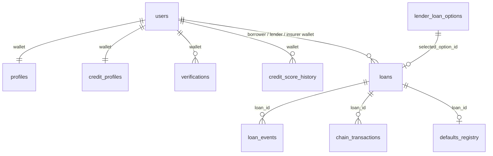

# Database

The API stores off-chain data in **SQLite** (default, zero configuration) or **Supabase PostgreSQL**. Both use the same table and column names. The database is a *projection of the chain*: balances and loan state are authoritative on-chain, and rows here are written only after a confirmed transaction (see [README.md](README.md#4-loan-state-machine-and-keeper)).

- SQLite schema: [`src/db/schema.sqlite.sql`](src/db/schema.sqlite.sql), created automatically on start. File: `backend/data/credloom.db` (git-ignored).
- Supabase: run [`src/db/supabase_migration.sql`](src/db/supabase_migration.sql) once, then set `DB_DRIVER=supabase`.

## Entity relationships

Relations are by wallet address or ID in application code; foreign-key constraints are not enforced in the database.

## Tables used by the application

| Table | Purpose | Key columns |
|---|---|---|
| `users` | accounts | `username`, `password_hash` (bcrypt), `primary_wallet`, **`role`** (`borrower`/`lender`/`insurer`), `status` |
| `profiles` | per-wallet profile and scoring history | `wallet`, `tier` (1–3), `total_transactions`, `num_previous_loans`, `total_previous_loans_eth`, `meta` (JSON, e.g. `wallet_age_days` for seeded users) |
| `credit_profiles` | current credit state | `credit_score`, `risk_state`, `tier`, `max_loan_amount`, `max_borrow_amount`, `max_duration_days`, `available_credit`, `utilization_rate`, `score_source` (`ml` / `heuristic`), `score_updated_at` |
| `credit_score_history` | every score change | `wallet`, `score`, `source`, `reason`, `created_at` |
| `verifications` | tier verification attempts | `wallet`, `verification_type` (`ENS` / `PASSPORT`), `status`, `provider`, `provider_id`, `score`, `verified_at` |
| `lender_profiles` | lender preferences | `wallet`, `active`, `min_score`, `base_apr_bps` |
| `lender_loan_options` | mirror of on-chain offers | **`chain_offer_id`** (unique), `lender_wallet`, `duration_days`, `amount_available`, `min_score`, `min_apr_bps`, `max_apr_bps`, `active`, `tx_create_hash` |
| `insurer_profiles` | insurer terms | `wallet`, `active`, `premium_bps` |
| `loans` | loan records | `loan_id` (`L<epoch>-<chainId>`), **`blockchain_loan_id`**, `borrower_wallet`, `lender_wallet`, `insurer_wallet`, `principal`, `interest_amount`, `insurance_premium`, `repaid_amount`, `apr_bps`, `credit_score_at_origination`, `status` (`active`/`repaid`/`defaulted`), `start_ts`, `due_ts`, `tx_create_hash`, `tx_repay_hash`, `tx_default_hash`, `insurance_payout` |
| `loan_events` | audit log | `type`, `loan_id`, `wallet`, `tx_hash`, `block_number`, `amount`, `details` (JSON) |
| `defaults_registry` | permanent default record | `wallet`, `loan_id`, `principal`, `default_ts`, `tx_hash`, `resolved` |
| `chain_transactions` | every transaction we sent | `tx_hash` (unique), `kind`, `wallet`, `loan_id`, `offer_id`, `block_number`, `gas_used`, `fee_eth`, `value_eth`, `status` |

Bold columns are the ones the earlier code assumed but your live Supabase schema did not have.

## Supabase notes

The live project was inspected before the migration was written. It already had `users`, `profiles`, `credit_profiles`, `verifications`, `lender_profiles`, `lender_loan_options`, `insurer_profiles`, `loans`, `loan_events` and `defaults_registry`, but lacked the columns and tables below. The migration is **additive and idempotent** (`add column if not exists`, `create table if not exists`):

- `users.role`
- `profiles.total_transactions`, `num_previous_loans`, `total_previous_loans_eth`
- `credit_profiles.score_source`, `score_updated_at`
- `lender_loan_options.chain_offer_id` (unique), `min_score`, `min_apr_bps`, `max_apr_bps`, `tx_create_hash`
- `loans.blockchain_loan_id`, `repaid_amount`, `credit_score_at_origination`, `insurance_payout`
- `loan_events.tx_hash`, `block_number`, `amount`, `details`
- new tables `chain_transactions`, `credit_score_history`, plus indexes

Tables present in Supabase but **not used** by this version: `loan_intents`, `wallets`, `risk_actions`, `borrower_features`, `liquidity_positions`. They can be ignored or dropped.

The Supabase driver passes queries straight to `@supabase/supabase-js` and uses the service-role key, which bypasses row-level security: keep that key server-side only. The Supabase path has not been exercised end to end in this repository's tests, which run on SQLite. After changing the driver, run `npm run seed` and `npm test`.

## SQLite adapter

`src/db/sqlite.js` implements the subset of the supabase-js query builder the application uses (`select/insert/update/upsert/delete`, `eq/neq/gt/gte/lt/lte/in/is`, `order`, `limit`, `single`, `maybeSingle`, counts) on top of `node:sqlite`, so every route is written once and runs on either database. Booleans and JSON columns are converted on the way in and out.
